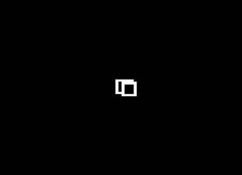
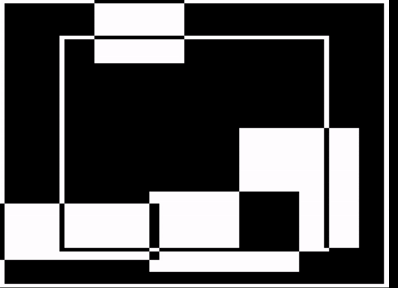
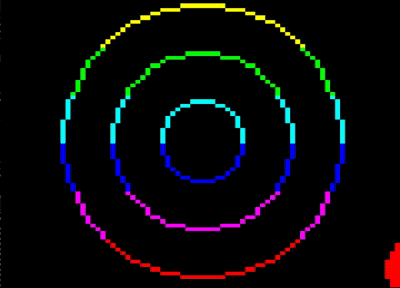
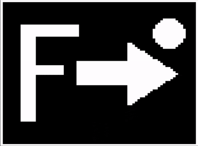
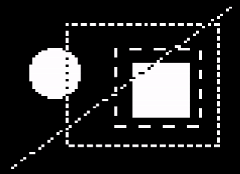

# Acorn System 3 6809 Teletext Graphics Library



The library follows the Bitshifters' teletextr routines (Kieran Connell and
Simon Morris, adapted from Bresenham routines by Rich Talbot-Watkins) see _Credits_ and uses
the Sixel graphics of the Acorn teletext VDU (6845 + SAA5050) on 6809-based
Acorn System machines. It is currently designed for Assembler calls only. It was built with _lwasm_.

The _build_ folder contains binaries for Linux (AMD64); for other platforms see _Building_ below.

Mame was used for testing and within the _mame_ folder is a bootable Acorn System 6809 Flex9 disk along with a disk 
containing the graphics library and demo binaries. Assuming Flex9 is booted to disk 0 and the `TGL.dsk` disk is 
inserted in disk 1, the following commands will load the graphics library and demo binaries. 

```text
+++ GET 1.TGL.BIN
+++ 1.CUBE.BIN
```

## Building

    make            # library for both targets, plus the demos
    make sys3       # standard Acorn System 3  (VDU $0400, CRTC $0800)
    make flex       # FLEX machine            (VDU $E400, CRTC $E800)
    make demo       # starburst demo only
    make cube       # rotating cube demo only
    make cubep      # patterned cube demo only
    make cubed      # die demo only
    make ship       # spaceship demo only
    make boxes      # rectangles demo only
    make circles    # circles demo only
    make flip       # flip-screen demo only
    make ants       # marching ants demo only
    make SAFE=1     # range-checked build (see below)
    make NOPACE=1   # TGL_PACE does nothing and never touches the VIA timer
    make test       # build, put the FLEX library and demos on TGL.dsk,
                    #  and start MAME
    make clean      # remove the build directory

Output is raw binary: `build/sys3/tgl.bin`, `build/flex/tgl.bin`,
`build/demo.bin`, `build/cube.bin`, `build/cubep.bin`, `build/cubed.bin`,
`build/ship.bin`, `build/boxes.bin`, `build/circles.bin`, `build/flip.bin`
and `build/ants.bin`, with listings alongside.

### Safe builds

`make SAFE=1` builds the library with range checks in `TGL_PLOT` and
`TGL_LINE`: an off-screen point is ignored, and a line with either
endpoint off screen draws nothing, instead of writing outside the buffer.
Use it while developing; a normal build leaves the checks out entirely
and is byte-for-byte unaffected. The build message ends with
"SAFE build" so you can tell which you have.

`make NOPACE=1` reduces `TGL_PACE` to a bare return, for programs that
need the VIA's Timer 2 for themselves and want a guarantee the library
never touches it (see `TGL_PACE` below). The two options can be combined.

`make` decides what to rebuild from file dates, so it won't notice that
an option has changed. When switching between build options, use
`make -B` (or `make clean` first).

## Demos

All the demos expect the library at $1000 and load at $2800, using a buffer
at $3800. (The library may grow to 6K, $1000-$27FF; the build stops with an
error if it gets any larger.) They work with either target's library build.
Press any key to exit (in `cube.bin`, any key except space).

- `demo.bin` - border and starburst drawn with `TGL_LINE`
- `cube.bin` - a tumbling, zooming cube with hidden lines removed, so it
  looks solid; press the space bar to switch to the full wireframe and
  back. Paced with `TGL_PACE` to a steady 25 frames per second. Its sine
  and projection tables are generated by `tools/gen_cube_tables.py`.
- `cubep.bin` - the same cube with each visible face filled in its own
  pattern (`TGL_POLYF` and `TGL_SETPAT`), the edges drawn on top.
- `cubed.bin` - the cube as a die: white faces with black spots and edges
  drawn in CLEAR mode. The spots are points on the cube's surface, rotated
  and projected like the corners, so they sit correctly in perspective;
  opposite faces add up to seven.

  The three cube demos share their code: `demo/cube_defs.inc` (settings
  and variables), `demo/cube_core.asm` (zoom, rotation, projection, face
  visibility and edges, with an explanation of the maths) and
  `demo/cube_fill.asm` (face filling, for `cubep` and `cubed`). The two
  filled versions run at roughly 6-10 frames per second, depending on how
  much of the screen the cube covers.

__Rotating Cube Demo.__


- `ship.bin` - an original spaceship design, the "Kestrel" courier,
  tumbling in perspective with hidden lines removed so it looks solid.
  About 79,000 cycles per frame (roughly 12-13 frames per second at 1MHz).
  The model is defined in `tools/gen_ship_model.py`, which checks it is
  convex and fits the projection tables, then writes `demo/ship_model.asm`.
  Edit the definition there to design your own ships.

__Rotating Space Ship Demo.__


- `boxes.bin` - four filled boxes drift and bounce in XOR mode, so their
  overlaps cancel out, sliding partly off the screen edges to show the
  clipping, with two outline frames (also XOR) on top, and a coloured
  title and frame counter on the status row. About 66,000 cycles per frame
  (roughly 15 frames per second at 1MHz).

__Boxes Demo__



- `circles.bin` - a filled ball bounces around, partly off the edges,
  while rings ripple outwards from the centre, all in XOR so the rings
  invert where they cross the ball. Six rainbow colour bands scroll slowly
  down the screen, with a coloured title on the status row.

__Circles Demo__



- `flip.bin` - a lopsided picture (a letter F, an arrow and a ball) that
  `TGL_FLIPH` turns over every couple of seconds, like a card: it narrows
  to the centre line and opens out again mirror-reversed.

__Horizontal Flip Demo__



- `ants.bin` - marching ants: two dashed boxes march clockwise round a
  small scene in SET mode (their gaps clear the pixels they cross, cutting
  into the ball), while a dashed diagonal crosses everything in XOR mode,
  marching the other way. About 140,000 cycles per frame, as it draws
  nearly 400 dashed pixels as well as the scene (roughly 8 frames per
  second); a single selection box costs far less.

__Moving Ants Demo__



## Using the Library

The binary is position-independent: load it anywhere. Define `TGL_BASE`
as the load address and `INCLUDE "tgl_api.inc"`; entry points are fixed
offsets from the load address.

Calling conventions:

- Enter every routine with **DP = $00**. The library's workspace is in
  page zero, $00-$7F (`src/ws.inc`), so programs can use $80 upwards.
- Registers are preserved unless a routine says otherwise.
- The stack belongs to the caller. `TGL_BLIT` borrows S briefly with IRQ
  and FIRQ masked.
- The off-screen buffer is 960 bytes (24 rows x 40). `TGL_INIT` places it
  immediately after the library; `TGL_SETBUF` puts it anywhere else.

Every build assembles the library at two different origins and fails if
the binaries differ, so position independence can't silently break.

## Routines

| Entry       | Offset | Function |
|-------------|--------|----------|
| TGL_INIT    | +0     | Reset 6845 start address, hide cursor, clear status row, all rows white, buffer after library, SET mode, solid fills |
| TGL_SETBUF  | +3     | X = off-screen buffer address |
| TGL_CLS     | +6     | Clear buffer to blank graphics (keeping row colours) |
| TGL_SETMODE | +9     | A = mode: 0 set, 1 clear, 2 XOR |
| TGL_PLOT    | +12    | A = x (0-77), B = y (0-71) |
| TGL_LINE    | +15    | A,B = x0,y0; X = x1:y1 (high:low) |
| TGL_BLIT    | +18    | Copy buffer to screen rows 0-23 |
| TGL_PLOTC   | +21    | Clipped plot: A,B = signed x,y (-128..127) |
| TGL_LINEC   | +24    | Clipped line: signed coordinates, as TGL_LINE |
| TGL_DONE    | +27    | Restore the text display (clears the screen) |
| TGL_INKEY   | +30    | Key waiting? Z set: none; Z clear: key in A |
| TGL_EXIT    | +33    | Restore the display, return to FLEX / the monitor |
| TGL_RECT    | +36    | Outline rectangle: corners as TGL_LINEC |
| TGL_RECTF   | +39    | Filled rectangle: corners as TGL_LINEC |
| TGL_CIRC    | +42    | Outline circle: A,B = signed centre x,y; X = radius (0-127) |
| TGL_CIRCF   | +45    | Filled circle: A,B = signed centre x,y; X = radius (0-127) |
| TGL_TEXT    | +48    | Status row text: A = column (0-39), X -> zero-terminated string |
| TGL_TCLR    | +51    | Clear the status row |
| TGL_TNUM    | +54    | Status row number: A = column, X = value (0-65535), 5 characters |
| TGL_COLOUR  | +57    | Row colour: A,B = first,last row (0-23), X = colour (1-7) |
| TGL_PACE    | +60    | Steady frame rate: A = frame length in 50Hz ticks (1-3) |
| TGL_POLYF   | +63    | Filled convex polygon: X -> corner count, then x,y pairs (signed) |
| TGL_SETPAT  | +66    | Fill pattern for TGL_POLYF and TGL_CIRCF: A = 0-15 (2x2 pixels) |
| TGL_FLIPH   | +69    | Card-turn flip of the buffer, left to right: A = 50Hz ticks per frame (1-3) |
| TGL_SETDASH | +72    | Dash pattern: A = pattern (bit 0 first), B = length (1-8), X = phase |
| TGL_LINED   | +75    | Dashed line: coordinates as TGL_LINEC |
| TGL_RECTD   | +78    | Dashed rectangle outline: corners as TGL_RECT |

`TGL_PLOT` and `TGL_LINE` do not range-check, for speed. `TGL_PLOTC` and
`TGL_LINEC` accept signed coordinates and draw only what is on screen;
`TGL_LINEC` trims lines to the screen edges (Cohen-Sutherland, rounded to
the nearest pixel) and then draws with `TGL_LINE`. Trimmed lines stay
within one pixel of the path the unclipped line would take.

`TGL_RECT` and `TGL_RECTF` take two opposite corners (A,B = x0,y0;
X = x1:y1) in any order, accept signed coordinates and clip to the screen.
Both use the current plot mode. `TGL_RECTF` fills whole character cells
at a time, six pixels per write, with only the edge cells handled pixel by
pixel: a full-screen fill takes about 36,000 cycles. `TGL_RECT` draws the
outline as four thin fills that never overlap, so every pixel is drawn
exactly once (in XOR mode, drawing a rectangle twice removes it); a
full-screen outline takes about 19,000 cycles.

`TGL_CIRC` and `TGL_CIRCF` take the radius in vertical pixels and scale
every width by 13/16, because teletext pixels are wider than they are
tall: the result is narrower than it is tall in pixels but looks round on
screen. Both clip and use the current plot mode, and the outline draws
every pixel exactly once, so XOR works. The circle is worked out a row at
a time with an integer midpoint method (additions only). A radius-20
outline takes about 34,000 cycles and a radius-20 filled circle about
52,000.

The status row is screen row 24, below the graphics. `TGL_BLIT` never
touches it, so text written there stays put while the graphics above it
change. `TGL_TEXT`, `TGL_TCLR` and `TGL_TNUM` write straight to the screen,
so text appears immediately. Strings stop at the right-hand edge rather
than wrapping, and may contain teletext control codes to colour the text
that follows: $81 red, $82 green, $83 yellow, $84 blue, $85 magenta,
$86 cyan, $87 white (each takes one character position and shows as a
space). `TGL_TNUM` always writes five characters, right-aligned with
leading spaces, so a shrinking value leaves no stray digits behind.

Teletext colours whole rows: each row of character cells starts with a
colour code, which the library keeps in column 0. `TGL_COLOUR` sets the
graphics colour of a band of rows (row r covers pixel rows y = 3r to
3r+2): 1 red, 2 green, 3 yellow, 4 blue, 5 magenta, 6 cyan, 7 white, also
available as `TGL_RED` ... `TGL_WHITE` in `tgl_api.inc`. The change goes
into the buffer straight away, shows at the next blit, and is remembered,
so `TGL_CLS` keeps each row's colour. Changing colours costs no pixels and
no drawing time.

`TGL_PACE` keeps a steady frame rate. Call it once per frame, just before
`TGL_BLIT`, with the frame length in 50Hz ticks: 1 for 50 frames per
second, 2 for 25, 3 for about 17. It waits until the period started by the
previous call has run out, then starts the next, so frames take the same
time however much was drawn; a frame that overran carries straight on. It
uses Timer 2 of the main VIA ($0980, or $E980 on the FLEX machine) in
one-shot mode, polling its flag without ever enabling its interrupt, and
only when it is called: nothing else in the library touches the VIA. The
monitor uses Timer 1 and leaves Timer 2 alone. A program that needs
Timer 2 simply doesn't call `TGL_PACE`, or uses a `NOPACE=1` build.
Pacing gives smooth, even motion but cannot prevent tearing, because the
6845's vertical sync isn't connected to anything the CPU can read.

`TGL_POLYF` fills a convex polygon of 3 or more corners (any convex shape,
triangles included), given as a block: the corner count, then each
corner's x and y as signed bytes, in either winding order. It clips to the
screen and uses the current plot mode and fill pattern. A pixel is filled
when its top-left corner is inside the polygon, so a polygon includes its
top and left edges but not its bottom and right ones: polygons that share
an edge neither overlap nor leave a gap, so faces fit together exactly and
XOR works across shared edges (a square from (0,0) to (10,10) fills 10 x 10
pixels). Edges are tracked with exact integer arithmetic, and each
character row is assembled from its three pixel rows so every cell is
written once. A full-screen fill takes about 104,000 cycles, a 30 x 30
square about 36,000.

`TGL_SETPAT` sets the fill pattern used by `TGL_POLYF` and `TGL_CIRCF`: a
2x2 block of pixels repeated across the screen (bit 0 even x, even y;
bit 1 odd x, even y; bit 2 even x, odd y; bit 3 odd x, odd y).
`tgl_api.inc` names the useful ones: `TGL_PAT_SOLID`, `TGL_PAT_75`,
`TGL_PAT_50` (checkerboard), `TGL_PAT_25`, `TGL_PAT_HLINES`,
`TGL_PAT_VLINES` and `TGL_PAT_EMPTY`. Outlines, lines, plots and rectangles
are always solid. `TGL_INIT` sets solid.

`TGL_FLIPH` turns the picture in the buffer over left-to-right as an
animated card turn, for splash screens and the like: the picture narrows
towards the centre line (following a cosine curve, the way a turning card
looks), goes edge-on, and opens out again mirror-reversed. It draws 15
frames straight onto the screen, pixel-smooth, each paced with `TGL_PACE`:
A is the frame length in 50Hz ticks, so 2 takes about 0.7 seconds and 3
about 1 second (a `NOPACE` build runs it as fast as it can). Afterwards the
buffer holds the mirror image and the screen shows it, so a second flip
turns it back. Row colours are unchanged. It works on the library's own
graphics: teletext text can't be mirrored (the SAA5050 has no reversed
characters), and control codes part-way along a row would end up in the
wrong place. It uses about 90 bytes of stack.

`TGL_LINED` and `TGL_RECTD` draw dashed lines and rectangle outlines,
for "marching ants" selection boxes and the like. `TGL_SETDASH` sets the
pattern: A holds up to 8 pixels of it, bit 0 first (1 drawn, 0 a gap), B
its length (1-8) and X the phase (in the low byte). `TGL_INIT` sets on,
on, off (A = %011, B = 3). Drawn pixels use the current plot mode and gaps
the opposite: cleared in SET mode, set in CLEAR mode, and left alone in
XOR mode, so XOR ants can run over a picture without harming it. The
pattern runs from the start point given towards the end point; for a
rectangle it runs clockwise from the top-left corner, carrying on round
the corners, with every pixel drawn once. Add 1 to the phase each frame
(calling `TGL_SETDASH` again) and the dashes march forward a pixel at a
time; subtract 1 and they march backwards. Both routines take signed
coordinates and clip a pixel at a time, so the pattern stays anchored to
the true start even when part of the shape is off screen. Horizontal and
vertical lines (including every rectangle edge) take a faster path: a
50 x 40 dashed box takes about 39,000 cycles, a 74-pixel diagonal about
31,000. The dash settings are kept inside the library itself, as the
page-zero workspace is full.

Cycle figures in this README come from the Python emulator used for
testing, which adds a cycle for every memory read on top of each
instruction's normal count, so its figures run high. Frame rates measured
in MAME suggest real costs are around 15-20% lower.

## System Routines

`TGL_DONE`, `TGL_INKEY` and `TGL_EXIT` use the monitor's RAM vectors, so
they work with any monitor version. `TGL_DONE` sends a form feed through
the console output vector: the monitor's handler re-detects the 6845,
reloads its registers (cursor and start address included), resets the
driver's scroll position and clears the screen. `TGL_INKEY` needs IRQs
enabled, since the monitor reads the keyboard under interrupt. `TGL_EXIT`
does a FLEX warm start on the FLEX machine and an `SWI` into the monitor
on a standard System 3.

Both machines run the same monitor source, built with BASE=$0000 for the
standard System 3 and BASE=$E000 for the FLEX machine, so the vectors and
buffer pointers sit at the same offsets in each monitor's RAM page.

## Testing

`tools/run_demo.py` runs the System 3 build and the demo in a Python 6809
emulator (`pip install MC6809`) and prints screen memory as a pixel grid:

    python3 tools/run_demo.py build/sys3/tgl.bin build/demo.bin 0400 <DONE address from build/demo.lst>

The emulator has no VIA, so `run_demo.py` holds Timer 2's flag set and
`TGL_PACE` never waits there. It also corrects a bug in the MC6809
package's `SEX` instruction (it never sets A to $FF for a negative B),
which would otherwise spoil the polygon fill.

## Credits

The approach follows the Bitshifters' teletextr routines (Kieran Connell and
Simon Morris, adapted from Bresenham routines by Rich Talbot-Watkins):
https://github.com/bitshifters/teletextr (MIT licence). The 6809 code here
is written for this library rather than translated; if any of their code is
ported directly in future, their copyright notice and licence text must be
included with it.
