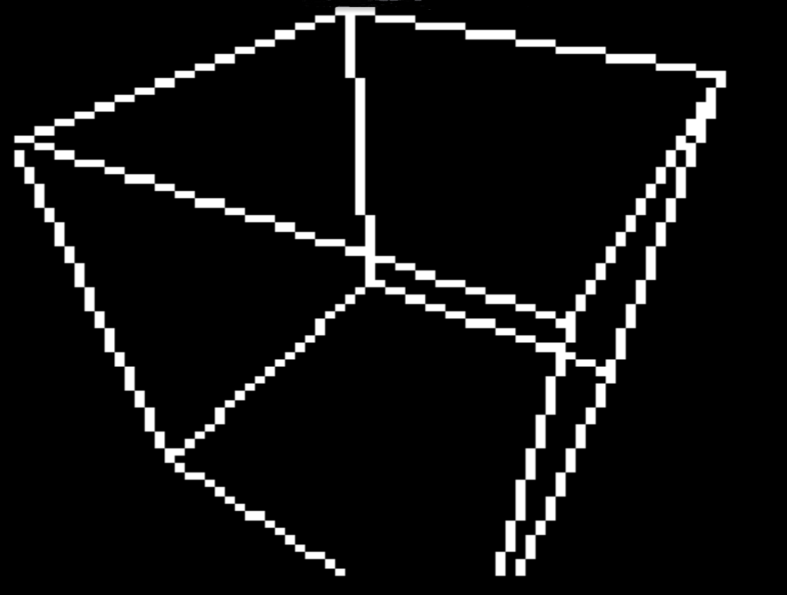
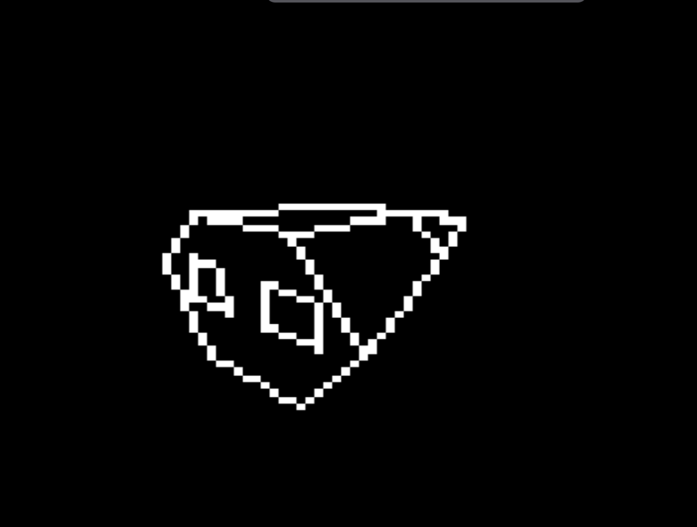

# Acorn System 3 6809 Teletext Graphics Library

The libray follows the Bitshifters' teletextr routines (Kieran Connell and
Simon Morris, adapted from Bresenham routines by Rich Talbot-Watkins) see _Credits_ and uses
the Sixel graphics of the Acorn teletext VDU (6845 + SAA5050) on 6809-based
Acorn System machines. It is currently designed for Assembler calls only. It was built with _lwasm_.

The _build_ folder contains binaries for Linux (AMD63), for other platforms see _Building_ below. alongside 

Mame was used for testing and within the _mame_ folder is a bootable Acorn System 6809 Flex9 disk along with a disk 
containing the graphics library and demo binaries. Assuming Flex9 is booted to disk 0 and the `TGL.dsk` disk is 
inserted in disk 1, the following commands will load the graphics library and demo binaries. 

```text
+++ GET TGL.BIN
+++ CUBE.BIN
```

## Building

    make            # library for both targets, plus the demos
    make sys3       # standard Acorn System 3  (VDU $0400, CRTC $0800)
    make flex       # FLEX machine            (VDU $E400, CRTC $E800)
    make demo       # starburst demo only
    make cube       # rotating cube demo only
    make ship       # spaceship demo only
    make SAFE=1     # range-checked build (see below)
    make test       # build, put the FLEX library and demos on TGL.dsk,
                    #  and start MAME
    make clean      # remove the build directory

Output is raw binary: `build/sys3/tgl.bin`, `build/flex/tgl.bin`,
`build/demo.bin`, `build/cube.bin` and `build/ship.bin`, with listings
alongside.

### Safe builds

`make SAFE=1` builds the library with range checks in `TGL_PLOT` and
`TGL_LINE`: an off-screen point is ignored, and a line with either
endpoint off screen draws nothing, instead of writing outside the buffer.
Use it while developing; a normal build leaves the checks out entirely
and is byte-for-byte unaffected. The build message ends with
"SAFE build" so you can tell which you have.

`make` decides what to rebuild from file dates, so it won't notice that
SAFE has changed. When switching between normal and safe builds, use
`make -B` (or `make clean` first).

## Demos

All the demos expect the library at $1000 and load at $2000, using a buffer
at $3000. They work with either target's library build. Press any key to
exit.

- `demo.bin` - border and starburst drawn with `TGL_LINE`
- `cube.bin` - rotating 3D cube, about 46,000 cycles per frame (roughly
  21 frames per second at 1MHz). Its sine and projection tables are
  generated by `tools/gen_cube_tables.py`.

__Image of a rotating cube which runs at about 25 frames per second.__


- `ship.bin` - an original spaceship design, the "Kestrel" courier,
  tumbling in perspective with hidden lines removed so it looks solid.
  About 79,000 cycles per frame (roughly 12-13 frames per second at 1MHz).
  The model is defined in `tools/gen_ship_model.py`, which checks it is
  convex and fits the projection tables, then writes `demo/ship_model.asm`.
  Edit the definition there to design your own ships.

__Image of a rotating space ship which runs at about 16 frames per second.__


## Using the library

The binary is position-independent: load it anywhere. Define `TGL_BASE`
as the load address and `INCLUDE "tgl_api.inc"`; entry points are fixed
offsets from the load address.

Calling conventions:

- Enter every routine with **DP = $00**. The library's workspace is in
  page zero (`src/ws.inc`).
- Registers are preserved unless a routine says otherwise.
- The stack belongs to the caller. `TGL_BLIT` borrows S briefly with IRQ
  and FIRQ masked.
- The off-screen buffer is 960 bytes (24 rows x 40). `TGL_INIT` places it
  immediately after the library; `TGL_SETBUF` puts it anywhere else.

Every build assembles the library at two different origins and fails if
the binaries differ, so position independence can't silently break.

## Routines

| Entry       | Offset | Function |
|-------------|--------|----------|
| TGL_INIT    | +0     | Reset 6845 start address, hide cursor, buffer after library, SET mode |
| TGL_SETBUF  | +3     | X = off-screen buffer address |
| TGL_CLS     | +6     | Clear buffer to blank graphics |
| TGL_SETMODE | +9     | A = mode: 0 set, 1 clear, 2 XOR |
| TGL_PLOT    | +12    | A = x (0-77), B = y (0-71) |
| TGL_LINE    | +15    | A,B = x0,y0; X = x1:y1 (high:low) |
| TGL_BLIT    | +18    | Copy buffer to screen rows 0-23 |
| TGL_PLOTC   | +21    | Clipped plot: A,B = signed x,y (-128..127) |
| TGL_LINEC   | +24    | Clipped line: signed coordinates, as TGL_LINE |
| TGL_DONE    | +27    | Restore the text display (clears the screen) |
| TGL_INKEY   | +30    | Key waiting? Z set: none; Z clear: key in A |
| TGL_EXIT    | +33    | Restore the display, return to FLEX / the monitor |

`TGL_PLOT` and `TGL_LINE` do not range-check, for speed. `TGL_PLOTC` and
`TGL_LINEC` accept signed coordinates and draw only what is on screen;
`TGL_LINEC` trims lines to the screen edges (Cohen-Sutherland, rounded to
the nearest pixel) and then draws with `TGL_LINE`. Trimmed lines stay
within one pixel of the path the unclipped line would take.

## System routines

`TGL_DONE`, `TGL_INKEY` and `TGL_EXIT` use the monitor's RAM vectors, so
they work with any monitor version. `TGL_DONE` sends a form feed through
the console output vector: the monitor's handler re-detects the 6845,
reloads its registers (cursor and start address included), resets the
driver's scroll position and clears the screen. `TGL_INKEY` needs IRQs
enabled, since the monitor reads the keyboard under interrupt. `TGL_EXIT`
does a FLEX warm start on the FLEX machine and an `SWI` into the monitor
on a standard System 3.

Both machines run the same monitor source, built with BASE=$0000 for the
standard System 3 and BASE=$E000 for the FLEX machine, so the vectors and
buffer pointers sit at the same offsets in each monitor's RAM page.

## Testing

`tools/run_demo.py` runs the System 3 build and the demo in a Python 6809
emulator (`pip install MC6809`) and prints screen memory as a pixel grid:

    python3 tools/run_demo.py build/sys3/tgl.bin build/demo.bin 0400 <DONE address from build/demo.lst>

## Credits

The approach follows the Bitshifters' teletextr routines (Kieran Connell and
Simon Morris, adapted from Bresenham routines by Rich Talbot-Watkins):
https://github.com/bitshifters/teletextr (MIT licence). The 6809 code here
is written for this library rather than translated; if any of their code is
ported directly in future, their copyright notice and licence text must be
included with it.
